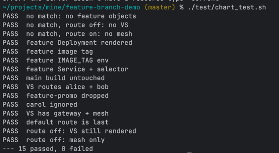

# feature-branch-demo

A Helm chart for deploying `service-a` and `service-b`. It can also run
feature-branch builds of a service, and Istio sends requests from chosen
users to those builds.

## Layout

```
chart/
  Chart.yaml
  values.yaml                 defaults shared by every service
  features.yaml               which users get which feature, per service
  service/<name>/<env>.yaml   per-service values (name, image, env)
  templates/
    _helpers.tpl              chart.features, chart.deployment
    deployment.yaml           main build
    service.yaml              main Service
    features.yaml             one Deployment + Service per active feature
    virtualservice.yaml       Istio routing (external route and/or x-user)
    ingress.yaml              Traefik -> istio-ingressgateway (route.enabled)
test/
  chart_test.sh               render tests
  features.yaml               test fixture
```

## Rendering

```sh
helm template <release> chart \
  -f chart/features.yaml \
  -f chart/service/service-b/prod.yaml
```

Put `features.yaml` before the service's own values file. To get an external
URL, add `--set route.enabled=true --set route.env=prod`. The host is then
`service-b.prod.apps.shirlenelim.se` (or `service-b.prod.127.0.0.1.nip.io`).

With the route on, `route.env` is required. The render fails without it
rather than producing a broken host.

## Feature routing

`chart/features.yaml`:

```yaml
users:            # allowlist
  - alice
  - bob

services:
  service-b:      # must match a service's `name`
    feature-new-cart:
      - alice
      - bob
    feature-promo:
      - carol     # not in users → ignored
```

For the service being rendered:

1. Users who aren't in `users` are dropped. A feature left with no users
   isn't deployed (above, `feature-promo` is skipped).
2. Each remaining feature gets its own Deployment and Service named
   `<service>-<feature>`. Its image is `<repository>:<feature>`, e.g.
   `service-b:feature-new-cart`, and that image must exist.
3. The VirtualService sends requests with `x-user: <listed user>` to the
   feature's Service. Everyone else gets the main build.
4. The VirtualService also covers the plain service name on the `mesh` gateway.
   Calls between services are therefore routed the same way, as long as the
   calling service passes the `x-user` header on. With `route.enabled: false`,
   the VirtualService routes only inside the cluster.

Each feature has its own Service, so ordinary Kubernetes load balancing never
sends other users' traffic to a feature build.

Feature builds are sized by `featureBuild` in `values.yaml` (1 replica, smaller
limits by default), not by the main build's `replicas`/`resources`. Scaling a
service in prod doesn't scale its feature previews.

A feature name must be a valid Kubernetes name: lowercase letters, digits and
`-`, starting with a letter, and short enough that `<service>-<feature>-app`
is at most 63 characters. Anything else fails at `helm template` time.

Try it once deployed:

```sh
curl -H 'x-user: alice' http://service-b.prod.apps.shirlenelim.se/   # feature-new-cart
curl                    http://service-b.prod.apps.shirlenelim.se/   # main
```

## Tests

```sh
test/chart_test.sh            # helm template checks
test/chart_test.sh --cluster  # also a server-side dry run against the current
                              # kubectl context (creates nothing)
```


You need `helm` installed, plus `kubectl` for `--cluster`. The script exits
non-zero if any check fails.

## To do

- [ ] **`x-user` can be spoofed.** Any client can send `x-user: alice` and get
      her feature build, since nothing checks or strips the header. Fine for
      previews, not for access control. Either document it as such, or route
      on a verified identity (e.g. a JWT claim via `RequestAuthentication`).
- [ ] **Image tag is tied to the feature name.** Branch names like
      `feature/new-cart` aren't valid tags. Allow an optional explicit tag per
      feature.
- [ ] **A user in two features silently gets only one.** Features match in
      alphabetical order, and the first wins. Reject the overlap, or document it.
- [ ] **Domain and gateway are hard-coded.** Move `apps.shirlenelim.se` and
      `istio-system/sample-gateway` into `values.yaml`.
- [ ] **Tests match text, not structure.** Move from `grep` on rendered YAML
      to helm-unittest (structural assertions) and kubeconform (schema checks
      without a cluster).
- [ ] **IDE files and screenshot are committed.** Add `.idea/` and `*.iml` to
      `.gitignore`. Replace `img.png` with pasted test output, which won't go
      stale.
- [ ] **`chart/features.yaml` configures `checkout-service`.** No such service
      exists, so it currently does nothing. Point it at a real service.
- [ ] **Deployments lack production basics.** Add readiness/liveness probes,
      a `securityContext`, and the standard `app.kubernetes.io/*` labels.
